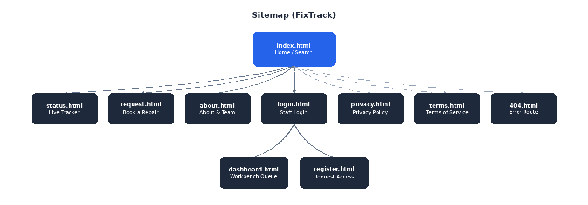
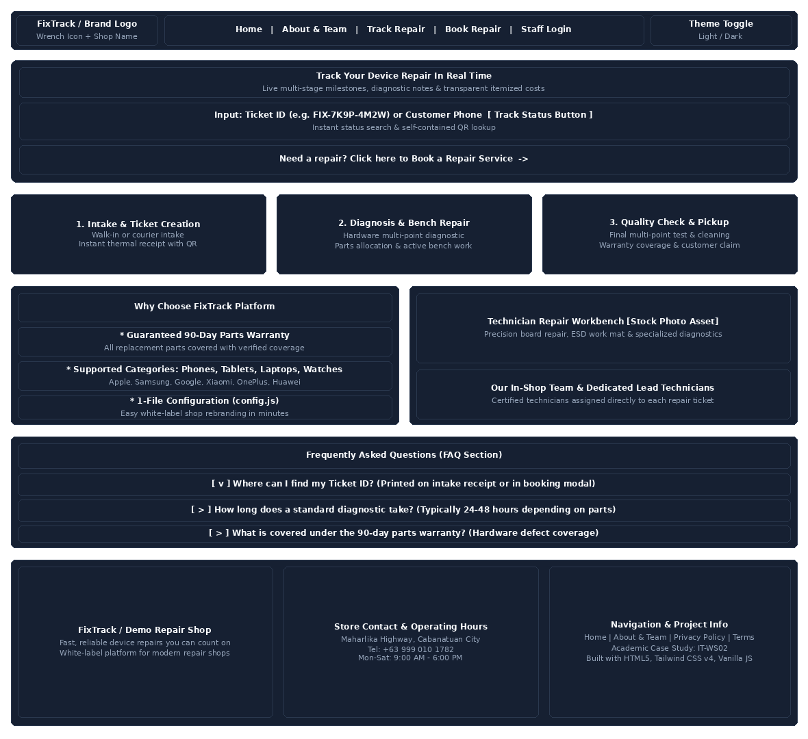

# FixTrack - White-Label Repair Tracking

FixTrack is a modern, front-end web application that works like Shopify, but for gadget repair shops. It gives repair shops a turnkey website where customers can book repairs, receive authentic printable receipts, and track their device's repair progress step-by-step in real time. Shop staff and technicians get a built-in workbench dashboard to manage active repair queues.

This project was built as an academic case study for IT-WS02. The current deployment is configured for a fictional shop called "Demo Repair Shop" based in Cabanatuan City.

## Key Features

* **Live 6-Stage Repair Tracker:** Customers can monitor their device progress across 6 canonical milestones: Device Received, Diagnostic, Awaiting Parts, Active Repair, Quality Check, and Ready for Pickup, complete with timestamped technician notes, inspection badges, and estimated completion dates.
* **Self-Contained Mobile QR Tracking:** Encodes ticket state directly into compact URL parameters so customers can scan the QR code with any mobile camera and track their device without needing a centralized external database.
* **Authentic Thermal Receipts:** Printable receipt slip formatted specifically for 58mm and 80mm thermal receipt printers, featuring monospace layout, dashed tear dividers, itemized billing, and an inline scannable QR code.
* **Secure Unguessable Ticket IDs:** Generates cryptographically randomized, non-sequential tracking codes (e.g. `FIX-7K9P-4M2W`) across 656 billion combinations, completely preventing ticket enumeration and protecting customer privacy.
* **Staff Workbench Console:** Dedicated technician workspace allowing staff to filter tickets by status, assign lead technicians, specify turnaround estimates, manage device serial numbers, log timestamped diagnostic updates, and customize line-item cost breakdowns.
* **Itemized Billing Breakdown:** Transparent accounting separating diagnostic fees, replacement parts, and bench labor, complete with automated VAT calculation and parts warranty coverage.
* **1-File White-Label Rebranding (`config.js`):** Easily rebrand the entire website in minutes by modifying `config.js`. Store name, tagline, contact details, operating hours, VAT rates, warranty duration, supported device brands, and team members update site-wide automatically.
* **Zero-Backend Architecture:** Runs entirely in modern browsers using `localStorage` for data persistence, ensuring high performance, zero server maintenance costs, and sub-200ms page load speeds.
* **Responsive Dark/Light Theme:** Built-in theme switcher with automatic system preference detection and persistent preference storage.

## Demo Accounts

All demo accounts share the password: `demo`

### Owners / Administrators
* **Alex Rivera:** `alex.rivera@demorepairshop.ph`
* **Prinz Charles Paderes:** `prinz.paderes@demorepairshop.ph`

### Technicians
* **Carlos Mendoza:** `carlos@demorepairshop.ph`
* **Sara Chen:** `sara.chen@demorepairshop.ph`
* **Mark Bautista:** `mark.bautista@demorepairshop.ph`
* **Adolph Jeremy Mangrubang:** `adolph.mangrubang@demorepairshop.ph`
* **Stephen Chua:** `stephen.chua@demorepairshop.ph`
* **Shian Chua:** `shian.chua@demorepairshop.ph`

## Tech Stack

* **HTML5:** Semantic document structuring with accessible ARIA labeling.
* **CSS3 / Tailwind CSS (v4):** Styled using Tailwind CSS v4 browser runtime with custom print stylesheets for authentic thermal receipts.
* **Vanilla JavaScript (ES6+):** Complete client-side reactive store, URL-based state encoding, and DOM manipulation without heavy frameworks.
* **QRCode.js:** Client-side vector canvas engine with modern mobile Android and thermal print compatibility.
* **Lucide Icons:** Clean, consistent SVG icon set.

## Project Structure

```text
fixtrack-web/
├── images/                   # Visual assets & diagrams
│   ├── devices/              # Sample device photos
│   ├── sitemap.png           # Architecture & routing hierarchy diagram
│   ├── wireframe.png         # Landing page wireframe layout
│   └── technician-repair.jpg # Stock hero repair asset
├── index.html                # Main landing page with ticket search & FAQs
├── request.html              # Customer repair booking intake form & success modal
├── status.html               # Live multi-stage tracker & printable receipt
├── dashboard.html            # Staff workbench console & ticket manager
├── about.html                # About FixTrack & development team roster
├── login.html                # Staff authentication portal
├── register.html             # Staff account access request form
├── privacy.html              # Customer privacy policy
├── terms.html                # Terms of service
├── 404.html                  # Custom error route
├── config.js                 # Master configuration, branding, pricing & seed data
├── qrcode.min.js             # Standalone QR code rendering library
├── script.js                 # Core application logic, data store & event handlers
├── styles.css                # Custom theme variables, animations & print stylesheet
├── favicon.svg               # SVG Wrench Favicon
├── banner.png                # OpenGraph fallback social banner
└── LICENSE                   # MIT License
```

## Project Planning

### Sitemap


### Wireframe

